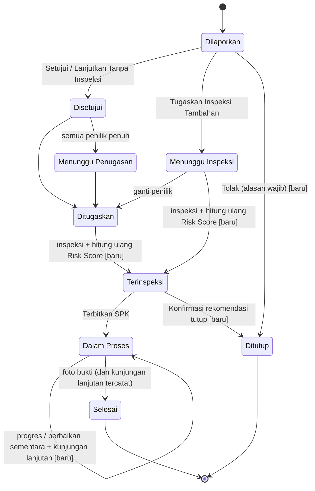

# Product Requirements Document (prd.md)
# SCMS-AI: Smart Complaint Management System — Dinas PUPR Kota Surabaya

**Versi Dokumen:** 3.0 (Sprint 1 & Sprint 2 Implemented — Sprint 3 Direncanakan, lihat [bagian 5](#5-sprint-3--rencana))  
**Organisasi / Tim:** Kelompok 7 (Kelas I3) — Rizaldi Rizki Saputra (187241005) & Alfarrel Yuri Ramadhani (187241109)  
**Target Instansi:** Dinas Sumber Daya Air dan Bina Marga (DSDABM / PUPR) Pemerintah Kota Surabaya  

## 1. Ringkasan Produk
SCMS-AI adalah platform web terintegrasi berbasis Artificial Intelligence (Computer Vision & NLP) dan Sistem Informasi Geografis (GIS) yang mengotomatiskan siklus hidup pengaduan kerusakan jalan di Kota Surabaya mulai dari pelaporan warga, deduplikasi spasial-semantik, prioritisasi berbasis risiko, verifikasi admin, penugasan penilik jalan, survei inspeksi lapangan, penerbitan SPK & perbaikan fisik, notifikasi warga, hingga evaluasi rating kepuasan publik.

## 2. Profil Pengguna & Hak Akses (RBAC)
| Aktor | Identifier Login | Hak Akses & Tanggung Jawab Utama | Halaman Tujuan |
| :--- | :--- | :--- | :--- |
| **Warga** | No. HP, Email, atau NIK | Membuat laporan 4 langkah (`/lapor`), melacak progres (`/lacak`), membuka notifikasi (`/notifikasi`), dan memberi rating 1-5 bintang (`/lacak/{id}/rating`). | `/Beranda` |
| **Admin (PPK)** | Email Instansi | Mengakses `/Dashboard`, memverifikasi laporan (`/verifikasi`), mengelola data master (`/master-data`), menugaskan penilik & menerbitkan SPK (`/work-orders`), serta melihat & mengunduh laporan kinerja (`/laporan-kinerja`, `/laporan-kinerja/unduh`). | `/Dashboard` |
| **Penilik Jalan** | Email atau NIP 18 Digit | Mengakses tugas lapangan (`/TugasLapangan`) yang **ditugaskan kepadanya** di wilayah rayonnya, menyimpan survei inspeksi (`Terinspeksi`), dan memperbarui progres SPK hingga `Selesai`. Melihat `/Dashboard` dan `/work-orders` wilayahnya sendiri dalam mode baca. | `/TugasLapangan` |
| **Kepala Bidang** | Email Instansi | Memantau `/Dashboard`, `/verifikasi`, `/work-orders`, `/master-data`, dan `/laporan-kinerja` (termasuk unduh CSV) dalam mode baca (read-only). | `/Dashboard` |

## 3. Aturan Bisnis Inti (Core Business Rules)
* **BR-1 (Validasi Foto & Deskripsi):** Foto wajib berupa berkas gambar asli `JPEG/PNG` (diperiksa dari bytes header via Pillow) dengan ukuran <= 10.0 MB dan terdeteksi sebagai objek jalan rusak. Deskripsi minimal 10 karakter. *(Revisi Sprint 3: AI tidak lagi menolak laporan; foto valid yang tidak terdeteksi atau tampak bukan jalan diterima sebagai "Perlu tinjauan manual" — lihat [5.3 BR-1](#53-aturan-bisnis-baru--berubah-sprint-3).)*
* **BR-2 (Formula Risk Score & Tingkat Prioritas — `app/services/risk_scoring.py`):**
  `Risk Score = clip(0.50*S + 0.45*ln(E+1) + 0.15*V + 0.25*C, 0.0, 10.0)`
  - `>= 8.0`: Prioritas `Urgent`
  - `6.0 - 7.9`: Prioritas `Tinggi`
  - `4.0 <= skor < 6.0`: Prioritas `Borderline` (`Butuh Verifikasi Lapangan`)
  - `< 4.0`: Prioritas `Rendah`
  - Tingkat prioritas menentukan urutan antrean dan warna peta, **tanpa target waktu penyelesaian**. Revisi dari masukan asisten dosen: konsep SLA (Rekomendasi SLA / batas waktu penyelesaian 24 jam s.d. 7x24 jam) **dihapus** dari seluruh aplikasi, karena perbaikan jalan secara nyata melewati birokrasi sehingga target waktu tersebut tidak realistis. Urgensi tiket cukup ditunjukkan dengan tingkat prioritas dari Risk Score, tanpa target waktu.
    Kolom `work_order.sla_rekomendasi` tidak di-drop (menghindari migrasi berisiko), tetapi **usang (deprecated)**: tidak lagi diisi maupun dibaca aplikasi.
  - *(Sprint 3: Risk Score dihitung ulang dengan severity lapangan setelah inspeksi — lihat [5.3 BR-2](#53-aturan-bisnis-baru--berubah-sprint-3).)*
  - **Skor ambigu** (UC-B) = tepat rentang Borderline, `4.0 <= skor < 6.0` (`skor_ambigu()` di `risk_scoring.py`). Skor **6.0** adalah skor jelas (`Tinggi`).
  - **Nilai S (severity) saat warga mengganti kategori AI** (`severity_laporan()` di `app/controllers/kontrol_pelaporan.py`):
    jika `kategori_pilihan` warga **sama** dengan rekomendasi AI, `S` = severity dari AI (kategori + luas area kerusakan).
    Jika **berbeda**, `S` = nilai dasar kategori pilihan (`VisiYolo.BASE_SEVERITY`: Jalan Berlubang `7.0`, Jalan Amblas `7.5`, Retak Permukaan `4.5`),
    bukan severity AI, dan halaman lapor menampilkan "Kategori diubah dari rekomendasi AI (...). Severity memakai nilai dasar kategori dan akan ditinjau petugas."
* **BR-3 (Deduplikasi Spasial-Semantik Dua Tingkat — `app/services/deduplikasi.py`):** Kandidat hanya WorkOrder aktif (belum `Selesai`) dengan kategori kerusakan yang sama. Laporan baru digabungkan ke tiket kandidat bila:
  * **Tingkat 1 — jarak <= 15 m (`RADIUS_PASTI_SAMA_M`):** langsung dianggap duplikat **tanpa** syarat kemiripan deskripsi (dasar: `"jarak <= 15 m"`).
  * **Tingkat 2 — jarak > 15 m s.d. <= 50 m (`RADIUS_DUPLIKAT_M`), atau tanpa koordinat tetapi nama jalan + nomor sama:** wajib kemiripan deskripsi >= ambang backend NLP (leksikal 0,35; sentence-transformers 0,60) (dasar: `"jarak + kemiripan deskripsi"`).
  * **Lebih dari 50 m:** bukan duplikat.
  * Bila ada beberapa kandidat, kandidat Tingkat 1 terdekat diutamakan; bila tidak ada, dipilih kandidat Tingkat 2 dengan kemiripan tertinggi.
  * *Alasan:* akurasi GPS ponsel hanya sekitar ±5–10 m, sehingga dua laporan berkategori sama dalam 15 m hampir pasti merujuk kerusakan yang sama; deskripsi warga sering tidak informatif (mis. tiket REP-2026-00361/00362/00363 terpaut 4–11 m tetapi kemiripan deskripsinya 0); dan setiap tiket tetap diverifikasi Admin serta Penilik Jalan, sehingga penggabungan keliru masih dapat dikoreksi. `exposure_count` bertambah +1 hanya jika pelapor adalah warga yang berbeda.
  * **Status laporan yang digabung mengikuti status tiket** (mis. `Dilaporkan`, lalu ikut berubah bersama tiket) agar linimasa warga konsisten; tidak ada nilai status khusus untuk laporan hasil penggabungan. Penggabungan ditandai lewat notifikasi "Laporan digabungkan" kepada pelapor dan entri `riwayat_status` tiket.
* **BR-4 (Alur Status Atomik — `app/services/alur_status.py`):**
  Urutan status: `Dilaporkan -> Disetujui / Menunggu Inspeksi / Menunggu Penugasan / Ditugaskan -> Terinspeksi -> Dalam Proses -> Selesai`.
  Transisi sah (`TRANSISI_SAH`): `Dilaporkan -> Disetujui | Menunggu Inspeksi`; `Disetujui -> Ditugaskan | Menunggu Penugasan`; `Menunggu Penugasan -> Ditugaskan`; `Menunggu Inspeksi -> Ditugaskan | Terinspeksi`; `Ditugaskan -> Terinspeksi`; `Terinspeksi -> Dalam Proses`; `Dalam Proses -> Selesai`.
  Setiap perubahan status wajib menggunakan pemeriksaan Compare-and-Set atomik, tidak boleh memundurkan status, wajib mencatat log ke tabel `riwayat_status`, dan wajib mengirim `notifikasi` ke seluruh warga pelapor pada tiket tersebut — **satu notifikasi per warga unik** per perubahan status (warga yang dua laporannya digabung ke tiket yang sama tidak menerima notifikasi ganda). *(Sprint 3: status akhir baru `Ditutup` — lihat [5.3 BR-4](#53-aturan-bisnis-baru--berubah-sprint-3) dan [5.5](#55-diagram-alur-status-sprint-3).)*
* **BR-5 (Keputusan Verifikasi — UC-B, `kontrol_verifikasi.py`):** Keputusan verifikasi hanya untuk tiket berstatus `Dilaporkan` dan backend hanya menerima aksi yang ditampilkan halaman:
  * Skor jelas -> `Setujui Tiket` (juga Aksi Cepat Dashboard) -> `Disetujui`.
  * Skor ambigu -> `Tugaskan Inspeksi Tambahan` (hanya ke Penilik Jalan wilayah tiket yang berstatus `Tersedia`) -> `Menunggu Inspeksi`, atau `Lanjutkan Tanpa Inspeksi` (dicatat di `log_keputusan`) -> `Disetujui`. Tiket ambigu tidak dapat disetujui lewat `Setujui Tiket` maupun Aksi Cepat Dashboard.
  * Setelah diputuskan, keputusan tidak dapat diubah dari halaman Verifikasi; penggantian Penilik Jalan (termasuk pada `Menunggu Inspeksi`) dilakukan di halaman Work Order (UC-G) dan tercatat di riwayat serta notifikasi.
* **BR-6 (Penugasan & Inspeksi — UC-G / UC-E):** Penilik Jalan **hanya** dapat menginspeksi tiket yang ditugaskan kepadanya: status `Ditugaskan`, atau `Menunggu Inspeksi` dengan `id_penilik` = dirinya. Tiket `Disetujui` yang belum ditugaskan tidak tampil sebagai tugas inspeksi dan POST inspeksinya ditolak; Admin wajib menugaskannya lebih dulu (UC-G). Identitas pemilik tugas dibandingkan berdasarkan ID akun, bukan nama.
* **BR-7 (Rating — UC-J / UC-L):** Satu rating per (warga, tiket). Bila dua laporan warga yang sama digabung ke satu tiket, rating kedua ditolak dengan pesan "Tiket penanganan ini sudah Anda beri penilaian melalui laporan ...". Rata-rata rating di Laporan Kinerja dihitung dari satu rating per warga unik (data lama ganda: hanya rating pertama yang dihitung).

## 4. Cakupan Skenario BDD (31 Skenario di `tests/features/`)
*Skenario Sprint 3 (`@sprint3`, belum dihubungkan ke step definition) dirangkum di [5.7](#57-skenario-bdd-sprint-3-sprint3).*
### Sprint 1 (17 Skenario)
* **UC-K (`uc_k_login.feature` — 5 skenario):** Login Warga, Admin, Penilik Jalan, kredensial salah, dan form kosong.
* **UC-A (`uc_a_buat_laporan.feature` — 4 skenario):** Laporan baru terbit tiket, deduplikasi otomatis, penolakan format/ukuran foto, dan penolakan objek bukan jalan *(skenario terakhir direvisi Sprint 3 menjadi "Perlu tinjauan manual" — lihat [5.3 BR-1](#53-aturan-bisnis-baru--berubah-sprint-3))*.
* **UC-B (`uc_b_verifikasi.feature` — 4 skenario):** Tabel urut Risk Score, setujui tiket jelas, tugaskan inspeksi tambahan skor ambigu, dan lanjutkan tanpa inspeksi dengan log keputusan.
* **UC-G (`uc_g_penugasan.feature` — 2 skenario):** Tugaskan Penilik Jalan tersedia (`Ditugaskan`) dan penanganan saat semua penilik penuh (`Menunggu Penugasan`).
* **UC-H (`uc_h_dashboard.feature` — 2 skenario):** Peta GIS & KPI prioritas serta filter multi-parameter dengan pesan kosong.

### Sprint 2 (14 Skenario)
* **UC-C (`uc_c_lacak_status.feature` — 2 skenario):** Warga melacak detail & timeline laporan (`LAP-2026-0001`) serta penanganan nomor tiket tidak ditemukan (`LAP-9999-XXXX`).
* **UC-D (`uc_d_kelola_master_data.feature` — 2 skenario):** Admin menambah Penilik Jalan baru dengan NIP 18 digit serta penolakan duplikasi NIP/Kode Wilayah.
* **UC-E (`uc_e_inspeksi_lapangan.feature` — 2 skenario):** Penilik Jalan menyimpan pada tiket yang ditugaskan kepadanya (`Ditugaskan`) dimensi kerusakan, catatan teknis, rekomendasi, dan foto survei (`Terinspeksi`), serta penolakan form inspeksi belum lengkap.
* **UC-F (`uc_f_update_perbaikan.feature` — 3 skenario):** Admin menerbitkan SPK (`Dalam Proses`), petugas menyelesaikan perbaikan dengan unggah foto bukti (`Selesai`), serta penolakan status `Selesai` tanpa foto bukti perbaikan.
* **UC-I (`uc_i_notifikasi_status.feature` — 1 skenario):** Warga mengklik notifikasi belum dibaca, status berubah menjadi dibaca, dan diarahkan ke halaman `/lacak` laporan terkait.
* **UC-J (`uc_j_rating_ulasan.feature` — 2 skenario):** Warga mengirim rating bintang 1-5 dan ulasan pada laporan `Selesai`, serta penolakan jika bintang belum dipilih.
* **UC-L (`uc_l_laporan_kinerja.feature` — 2 skenario):** Kepala Bidang melihat rekap kinerja per wilayah, rata-rata durasi per tahap penanganan, dan tiket aktif tertua beserta tahapnya, lalu mengunduh CSV rekap wilayah; serta pesan `"Tidak ada data kinerja pada periode yang dipilih"` tanpa tombol unduh jika periode kosong.
  * **Isi laporan (revisi asisten dosen, tanpa SLA):** total tiket, tingkat penyelesaian, rata-rata waktu penyelesaian (hari), rekap per wilayah dan per prioritas, rating warga, ditambah:
    (a) **rata-rata durasi per tahap** dari `riwayat_status` dalam hari — Verifikasi (laporan masuk → keputusan verifikasi `Disetujui`/`Menunggu Inspeksi`), Penugasan (keputusan verifikasi → `Ditugaskan`), Inspeksi Lapangan (`Ditugaskan` → `Terinspeksi`), Penerbitan SPK (`Terinspeksi` → `Dalam Proses`), Perbaikan (`Dalam Proses` → `Selesai`) — keseluruhan dan per prioritas. Waktu tiap status = pertama kali status itu dicapai. Tahap yang tidak dilalui tiket (mis. jalur inspeksi tambahan tanpa `Ditugaskan`) atau belum selesai tidak dihitung untuk tiket itu;
    (b) untuk tiket aktif: **umur tiket** (hari sejak laporan masuk) dan **tahap saat ini**, diurutkan dari yang paling lama.
  * Ekspor CSV per wilayah dan per tiket memuat durasi per tahap dan umur tiket (tanpa kolom SLA); proteksi formula CSV tetap berlaku. Kepatuhan SLA, "Aktif Melewati SLA", dan status SLA per tiket dihapus.

## 5. Sprint 3 — Rencana
> **Status:** perencanaan (PRD + skenario BDD ditulis lebih dulu, sebelum kode). Belum ada perubahan pada `app/`, `database/`, maupun step definition. Bagian 1–4 di atas tetap menggambarkan aplikasi yang sudah berjalan (Sprint 1 & 2).
> **Revisi asisten dosen tetap berlaku:** tidak ada target waktu penyelesaian di fitur Sprint 3 mana pun (termasuk grafik kinerja dan jadwal kunjungan lanjutan, yang hanya berupa tanggal rencana kerja, bukan tenggat).

### 5.1 Tujuan Sprint 3
1. Menutup siklus hidup tiket: tiket yang tidak perlu diperbaiki dapat **ditutup dengan alasan** (status akhir `Ditutup`), dan perbaikan sementara dapat dijadwalkan **kunjungan lanjutan** sebelum `Selesai`.
2. Membuat prioritas mencerminkan kondisi lapangan: **Risk Score dihitung ulang** dengan severity hasil inspeksi.
3. Memastikan warga benar-benar menerima kabar: **status pengiriman notifikasi**, percobaan ulang otomatis, **Kirim Ulang** oleh Admin, serta badge/toast yang **memperbarui diri tanpa refresh**.
4. Memberi Kepala Bidang **grafik kinerja** yang angkanya identik dengan tabel Laporan Kinerja.
5. Mengintegrasikan seluruh fitur dan mengujinya lewat skenario BDD `@sprint3`.

### 5.2 Fitur per Backlog & Penanggung Jawab
| # | Backlog Sprint 3 | Penanggung Jawab | Cakupan | Feature BDD |
| :--- | :--- | :--- | :--- | :--- |
| 1 | Memperbarui Status Perbaikan dan Notifikasi Otomatis | Rizaldi | Status akhir `Ditutup` (BR-4, BR-5); status pengiriman, percobaan ulang otomatis, dan **Kirim Ulang** notifikasi (BR-8) | `uc_b_tutup_tiket.feature`, `uc_i_kirim_ulang_notifikasi.feature` |
| 2 | Menerima Notifikasi Perubahan Status Laporan (push notification) | Alfarrel | Polling ringan `GET /api/notifikasi/belum-dibaca` (bawaan tiap 15 detik), badge `#badgeNotif` diperbarui tanpa refresh, toast di halaman, Notification API browser bila warga memberi izin. **Tanpa** Web Push/VAPID/service worker. | `uc_i_push_notifikasi.feature` |
| 3 | Memantau Laporan Ringkasan Kinerja (grafik) | Alfarrel | Chart.js di `/laporan-kinerja`: tren tiket masuk vs selesai per minggu, distribusi prioritas, rata-rata durasi per tahap, rekap per wilayah. Mengikuti filter periode/wilayah; periode kosong = tanpa grafik dengan pesan yang sudah ada. Angka grafik diambil dari struktur data yang sama dengan tabel. | `uc_l_grafik_kinerja.feature` |
| 4 | Integrasi dan Pengujian BDD Seluruh Fitur | Rizaldi & Alfarrel | Menghubungkan 8 feature `@sprint3` ke step definition; 350 tes yang ada tetap hijau; laporan pengujian (`generate_bdd_report.py`) mendapat kelompok Sprint 3. | semua feature `@sprint3` |

**Carry-over subtask Sprint 2** — ⚠️ *CARRY-OVER: direncanakan di Sprint 2 tetapi belum ada di aplikasi.* Penanggung jawab mengikuti pemilik modul terkait (disetujui tim):

| Carry-over | PJ | Cakupan | Feature BDD |
| :--- | :--- | :--- | :--- |
| ⚠️ CO-1 Hitung ulang Risk Score setelah inspeksi | Alfarrel | Konfirmasi kategori + tingkat kerusakan di form inspeksi (BR-2) | `uc_e_hitung_ulang_risiko.feature` |
| ⚠️ CO-2 Temuan baru saat inspeksi | Alfarrel | Tiket baru bersumber "Temuan Penilik" | `uc_e_temuan_baru.feature` |
| ⚠️ CO-3 Kunjungan lanjutan (kolom `perbaikan.jadwal_lanjutan` yang belum dipakai) | Rizaldi | Perbaikan sementara + jadwal kunjungan lanjutan | `uc_f_kunjungan_lanjutan.feature` |
| ⚠️ CO-4 Keputusan foto tanpa deteksi AI | Rizaldi (UC-A) & Alfarrel (UC-B) | Laporan "Perlu tinjauan manual" (BR-1, BR-5) | `uc_a_tinjauan_manual.feature` |

### 5.3 Aturan Bisnis Baru / Berubah (Sprint 3)
* **BR-1 (direvisi Sprint 3) — AI tidak pernah menolak laporan:** Validasi berkas tidak berubah: hanya berkas yang bukan JPEG/PNG asli (diperiksa via Pillow) atau > 10 MB yang ditolak ("Format harus JPG/PNG dan ukuran maksimal 10MB"). Di **kedua mode AI** (`simulasi` dan `yolov8`), foto valid yang **tidak terdeteksi kerusakannya** atau **tampak bukan jalan** **tidak ditolak**: laporan diterima dengan label **"Perlu tinjauan manual"**, kategori dipilih warga sendiri, dan `S` = nilai dasar kategori pilihan (`VisiYolo.BASE_SEVERITY`, sama seperti aturan ganti kategori di BR-2). Keputusan menolak dipindahkan ke manusia: Admin dapat **"Tolak"** saat verifikasi dengan alasan **"Laporan tidak valid"** (→ `Ditutup`, BR-4/BR-5). Backend simulasi: kata kunci bukan-jalan (`kucing`, `selfie`, dst.) dan nama berkas berisi `tanpa_deteksi` sama-sama menghasilkan "Perlu tinjauan manual". Tidak ada kotak deteksi yang dibuat-buat (`kotak_deteksi` kosong).
  * **Revisi skenario Sprint 1:** skenario UC-A "Photo Does Not Contain a Road Damage Object" (`kucing.jpg` ditolak dengan "Objek jalan rusak tidak terdeteksi, silakan ambil ulang foto") **diganti** oleh skenario "Photo that looks like a non-road object goes to manual review" di `uc_a_tinjauan_manual.feature`. **Terimplementasi (Bagian 1B):** teks skenario lama di `uc_a_buat_laporan.feature` diganti menjadi "Photo Not Recognised as Road Damage Goes to Manual Review" (tingkat controller; jumlah skenario UC-A tetap 4) dan step `test_uc_a.py` disesuaikan; alur wizard lengkapnya diuji oleh skenario `uc_a_tinjauan_manual.feature`. Skenario UC-A lain tidak berubah.
* **BR-2 (diubah) — Hitung ulang setelah inspeksi:** Form inspeksi (UC-E) mewajibkan penilik **mengonfirmasi kategori** dan memilih **tingkat kerusakan lapangan**: `Ringan = 3`, `Sedang = 5`, `Berat = 7`, `Sangat Berat = 9`. Tingkat kerusakan **tidak wajib hanya** bila penilik memilih "Rekomendasikan Tutup" dengan alasan **"Tidak ditemukan kerusakan"** (Risk Score tidak dihitung ulang); untuk alasan tutup lain dan untuk rekomendasi perbaikan tetap wajib. Saat inspeksi disimpan, Risk Score, prioritas, dan warna (badge/peta, lewat `warna_prioritas()`) dihitung ulang dengan formula BR-2 yang sama, memakai **severity lapangan menggantikan severity AI** (E, V, C tidak berubah). Severity AI tetap disimpan untuk perbandingan dan ditampilkan berdampingan. Perubahan dicatat di `riwayat_status`: **"Risk Score diperbarui X → Y berdasarkan inspeksi"**. Hitung ulang tidak menambah transisi status baru. Contoh data seed: REP-2026-00298 (8.0 Urgent) → Ringan 5.5 Borderline; Sangat Berat 8.5 Urgent.
* **BR-4 (diubah) — Status akhir `Ditutup`:** status final baru di samping `Selesai`, **alasan wajib** salah satu dari: `Tidak ditemukan kerusakan`, `Laporan tidak valid`, `Sudah diperbaiki pihak lain`, `Di luar kewenangan DPUPR`. Dua pintu, keduanya lewat `ubah_status()` (compare-and-set, `riwayat_status`, satu notifikasi per warga unik yang **memuat alasan**):
  * (a) **Admin "Tolak" saat verifikasi** — `Dilaporkan → Ditutup`.
  * (b) **Setelah inspeksi** — penilik memilih **"Rekomendasikan Tutup"** + alasan; tiket menjadi `Terinspeksi` dengan rekomendasi tertunda. Admin di halaman Work Order memilih **"Konfirmasi Tutup Tiket"** (`Terinspeksi → Ditutup`) atau **"Tolak Rekomendasi"** (tetap `Terinspeksi`, dicatat di riwayat, lalu SPK dapat diterbitkan). Selama rekomendasi tertunda, SPK belum dapat diterbitkan.
  * Tiket `Ditutup` **tidak dapat dirating** (UC-J), **tidak dihitung sebagai `Selesai`** maupun aktif, tidak menjadi kandidat deduplikasi BR-3. Di Laporan Kinerja tiket `Ditutup` **tidak dihitung** di total tiket, tingkat penyelesaian, maupun distribusi prioritas, dan ditampilkan **terpisah per alasan**.
* **BR-5 (diubah) — Keputusan Verifikasi:** setiap tiket `Dilaporkan` dapat **"Tolak"** (→ `Ditutup`, alasan wajib). Tiket **"Perlu tinjauan manual"** diperlakukan seperti **skor ambigu** apa pun Risk Score-nya: hanya `Tugaskan Inspeksi Tambahan`, `Lanjutkan Tanpa Inspeksi`, atau `Tolak`; tidak dapat `Setujui Tiket` maupun Aksi Cepat Dashboard. `alasan_ditolak()` diperluas sesuai kombinasi ini.
* **BR-8 (baru) — Pengiriman Notifikasi:** setiap `Notifikasi` memiliki `status_kirim` ∈ {`Menunggu`, `Terkirim`, `Gagal`} (kolom sudah ada). Pengiriman melalui **kanal tersimulasi** yang tingkat gagalnya diatur env `SCMS_NOTIF_TINGKAT_GAGAL` (0.0–1.0, **bawaan 0** agar tes stabil). Bila gagal, sistem mencoba ulang otomatis **maksimal 3 kali** (1 pengiriman awal + 3 percobaan ulang); setelah itu status tetap `Gagal`. Admin dapat menekan **"Kirim Ulang"** dari daftar **Notifikasi Gagal**; berhasil → `Terkirim`. Kegagalan pengiriman **tidak membatalkan** perubahan status tiket, dan notifikasi in-app tetap tersimpan.
  **Terimplementasi (Bagian 3):** logika kirim di `app/services/pengiriman_notifikasi.py`, dipanggil dari `kirim_notifikasi()` sehingga semua jalur notifikasi ikut (perubahan status, "Laporan diterima", "Laporan digabungkan"); kolom baru `notifikasi.jumlah_percobaan` (bawaan 0) dan `notifikasi.waktu_percobaan_terakhir`; `status_kirim` hanya mewakili kanal luar tersimulasi (notifikasi in-app tetap tampil di `/notifikasi` warga). Halaman `GET /notifikasi-gagal` (Admin + Kabid, tautan "Notifikasi Gagal" dengan badge jumlah di navigasi staf) dan `POST /notifikasi-gagal/{id}/kirim-ulang` (hanya Admin; Kabid 403; notifikasi yang bukan `Gagal` ditolak). Kirim Ulang menjalankan satu siklus kirim lagi (1 + maks. 3 percobaan). Seed: satu notifikasi demo `Gagal` (`NTF-SEED-0003`, 4 percobaan).
  *Penomoran:* BR-5 sudah dipakai untuk Keputusan Verifikasi, sehingga pengiriman notifikasi diberi nomor **BR-8** (disetujui tim).
* **Kunjungan lanjutan (UC-F, CO-3):** saat update progres, penilik dapat mencentang **"Perbaikan sementara"** dan wajib mengisi **jadwal kunjungan lanjutan** (tanggal **setelah hari ini**, disimpan di `perbaikan.jadwal_lanjutan`). Tiket tetap `Dalam Proses`; jadwal tampil di Tugas Lapangan dan linimasa warga ("Kunjungan lanjutan dijadwalkan"). Tiket **baru boleh `Selesai` setelah kunjungan lanjutan dicatat**; kunjungan **boleh dicatat sebelum tanggal jadwalnya**. Jadwal **boleh diubah berkali-kali secara berurutan**, tetapi **hanya satu jadwal aktif** pada satu waktu (jadwal lama tercatat di riwayat "Kunjungan lanjutan dijadwalkan ulang"). Jadwal adalah rencana kerja, bukan tenggat.
* **Temuan baru (UC-E, CO-2):** saat inspeksi, penilik dapat mencatat kerusakan lain di sekitar lokasi (foto **wajib**, kategori, deskripsi, titik peta). Sistem membuat tiket baru bersumber **"Temuan Penilik"** berstatus `Dilaporkan` yang masuk antrean Verifikasi seperti biasa dan **tetap melewati deduplikasi BR-3** (bila digabung, tidak ada tiket baru). Temuan tidak mengubah status tiket yang sedang diinspeksi dan tidak menambah `exposure_count` (exposure tetap dihitung dari warga berbeda). Penyimpanan: `laporan.id_warga` menjadi **nullable**, kolom baru `laporan.sumber` (`"Warga"` / `"Temuan Penilik"`) dan `laporan.id_penilik_pencatat`. **Notifikasi hanya ke warga pelapor:** tiket temuan murni tidak mengirim notifikasi warga; bila kemudian laporan warga digabung (BR-3) ke tiket temuan, warga itu menerima notifikasi "Laporan digabungkan" dan notifikasi perubahan status berikutnya (aturan satu notifikasi per warga unik di BR-4 tetap berlaku).

### 5.4 Ringkasan Carry-over Sprint 2
⚠️ Empat subtask berikut tercatat di backlog Sprint 2 tetapi belum diimplementasikan; masuk Sprint 3 sebagai CO-1 s.d. CO-4 (lihat 5.2 & 5.3): hitung ulang risk score setelah inspeksi, temuan baru saat inspeksi, kunjungan lanjutan (`jadwal_lanjutan`), dan keputusan foto tanpa deteksi AI.

### 5.5 Diagram Alur Status (Sprint 3)

`TRANSISI_SAH` Sprint 3 = transisi BR-4 yang ada **ditambah** `Dilaporkan -> Ditutup` dan `Terinspeksi -> Ditutup`. `Ditutup` dan `Selesai` adalah status final (tanpa transisi keluar); status tidak pernah mundur.

### 5.6 RBAC untuk Aksi Baru
| Aksi baru (Sprint 3) | Warga | Admin (PPK) | Kepala Bidang | Penilik Jalan |
| :--- | :---: | :---: | :---: | :---: |
| Tolak laporan saat verifikasi (→ `Ditutup`) | – | ✅ | 👁️ lihat saja | – |
| Rekomendasikan Tutup saat inspeksi | – | – | – | ✅ tiket yang ditugaskan kepadanya |
| Konfirmasi Tutup Tiket / Tolak Rekomendasi | – | ✅ | 👁️ lihat saja | – |
| Konfirmasi kategori & tingkat kerusakan (hitung ulang Risk Score) | – | – | – | ✅ tiket yang ditugaskan kepadanya |
| Catat temuan baru | – | – | – | ✅ dari tiket yang ditugaskan kepadanya |
| Perbaikan sementara, jadwal & catat kunjungan lanjutan | – | ✅ (form progres Admin) | – | ✅ tiket yang ditugaskan kepadanya |
| Daftar Notifikasi Gagal | – | ✅ | 👁️ lihat saja | – |
| Kirim Ulang notifikasi | – | ✅ | – (403) | – |
| `GET /api/notifikasi/belum-dibaca` (polling badge/toast) | ✅ notifikasinya sendiri | – (403) | – (403) | – (403) |
| Grafik Laporan Kinerja | – | ✅ | ✅ | – |

Tanpa login: halaman dialihkan ke `/Login`; endpoint JSON polling mengembalikan `401` tanpa data.

### 5.7 Skenario BDD Sprint 3 (`@sprint3`)
33 skenario di 8 file baru `tests/features/`, ditulis sebelum kode. Skenario dihubungkan ke step definition per bagian implementasi (dengan `@scenario` satu per satu bila sebagian skenario di file yang sama belum dikerjakan); skenario yang belum dihubungkan belum ikut dijalankan `pytest`. Data seed yang dipakai/dibutuhkan ditulis di komentar tiap file.

| Feature | Skenario | PJ |
| :--- | :---: | :--- |
| `uc_e_hitung_ulang_risiko.feature` | 4 | Alfarrel (CO-1) — **terimplementasi seluruhnya:** Bagian 1A "Field damage level lowers the Risk Score and priority", "Field damage level raises the priority and the map colour follows", "Inspection without a damage level is rejected"; Bagian 1B Scenario Outline "Damage level is optional only when no damage is found" (2 contoh) |
| `uc_b_tutup_tiket.feature` | 4 | Rizaldi — **terimplementasi (Bagian 1B):** "Admin rejects a report during verification", "Closing a ticket without a reason is rejected", "Inspector recommends closing and the admin confirms", "Admin rejects the closing recommendation and continues to the SPK" |
| `uc_a_tinjauan_manual.feature` | 4 | Rizaldi & Alfarrel (CO-4) — **terimplementasi (Bagian 1B):** "Valid photo without AI detection is accepted for manual review", "Photo that looks like a non-road object goes to manual review", "Manual-review ticket is treated as an ambiguous score and can be rejected", "Invalid file is still rejected under BR-1" |
| `uc_e_temuan_baru.feature` | 4 | Alfarrel (CO-2) — **terimplementasi (Bagian 2A):** "Inspector records a new finding that becomes a new ticket", "Citizen report merged into a finding ticket gets notifications", "Finding close to an active ticket is merged by BR-3 deduplication", "Finding without a photo is rejected" |
| `uc_f_kunjungan_lanjutan.feature` | 5 | Rizaldi (CO-3) — **terimplementasi (Bagian 2B):** "Inspector records a temporary repair with a follow-up schedule", "Ticket cannot be completed before the follow-up visit is recorded", "Follow-up visit date in the past is rejected", "Ticket is completed after the follow-up visit is recorded early", "Rescheduling replaces the single active follow-up visit" |
| `uc_i_kirim_ulang_notifikasi.feature` | 4 | Rizaldi — **terimplementasi (Bagian 3):** "Notification is delivered on the first attempt", "Failed notification is retried automatically and listed as failed", "Admin resends a failed notification", "Head of Division cannot resend notifications" |
| `uc_i_push_notifikasi.feature` | 4 | Alfarrel — **terimplementasi (Bagian 5):** "Badge and toast update without refreshing the page", "Browser notification is shown when the citizen grants permission", "Permission denied falls back to the in-page toast only", "Unread-count endpoint is only for the logged-in citizen" |
| `uc_l_grafik_kinerja.feature` | 4 | Alfarrel — **terimplementasi (Bagian 4):** "Charts show the same numbers as the tables", "Charts follow the region filter", "Closed tickets are shown separately and not counted as completed", "Empty period shows no charts" |
| `integrasi_alur_penuh.feature` | 2 | Rizaldi & Alfarrel (backlog 4) — **terimplementasi (Bagian 6):** "A citizen report goes from submission to rating", "A rejected report is closed with a reason"; satu tiket melewati semua aktor dan status lewat rute web sungguhan |

### 5.8 Data Seed & Konfigurasi yang Dibutuhkan
* **Dipakai ulang:** REP-2026-00298/LAP-2026-0002 (Ditugaskan, Budi Santoso, Ibu Sari Rahayu), REP-2026-00341/LAP-2026-0001 (Bpk. Tri Wahyudi; status disiapkan step seperti UC-F/UC-J), data periode Oktober 2026 (5 tiket: Urgent 2, Tinggi 2, Borderline 1; Selesai 1), notifikasi NTF-SEED-0001.
* **Opsional baru:** REP-2026-00370 / LAP-2026-0004 (`Dilaporkan`, skor jelas, USR-01, Wilayah Gubeng) agar skenario Tolak tidak perlu menyiapkan status langsung.
* **Konfigurasi baru:** `SCMS_NOTIF_TINGKAT_GAGAL` (bawaan 0), interval polling yang dapat diperkecil saat tes (mis. `SCMS_POLL_NOTIF_DETIK`, bawaan 15), kata kunci simulasi `tanpa_deteksi`.
* **Kolom baru (via `pastikan_kolom_terbaru()`):** `work_order.alasan_ditutup`, `work_order.severity_ai`; `inspeksi.kategori_terkonfirmasi`, `inspeksi.tingkat_kerusakan`, `inspeksi.severity_lapangan`, `inspeksi.rekomendasi_tutup` (+ alasan); `laporan.id_warga` menjadi nullable, `laporan.sumber`, `laporan.id_penilik_pencatat`, `laporan.perlu_tinjauan_manual`; `perbaikan.perbaikan_sementara`, penanda kunjungan lanjutan tercatat; `notifikasi.jumlah_percobaan`. Kolom usang `work_order.sla_rekomendasi` tidak disentuh.

### 5.9 Keputusan Tim
Jawaban atas pertanyaan terbuka perencanaan Sprint 3 (sudah diterapkan di 5.2–5.8 dan di feature `@sprint3`):
1. **Penomoran:** aturan pengiriman notifikasi memakai **BR-8** (BR-5 tetap Keputusan Verifikasi).
2. **PJ carry-over** disetujui: CO-1 & CO-2 Alfarrel, CO-3 Rizaldi, CO-4 Rizaldi (UC-A) & Alfarrel (UC-B).
3. **Temuan penilik:** `laporan.id_warga` nullable + `laporan.sumber` (`"Warga"` / `"Temuan Penilik"`) + `laporan.id_penilik_pencatat`. Notifikasi hanya ke warga pelapor; tiket temuan murni tidak mengirim notifikasi warga, dan warga yang laporannya kemudian digabung ke tiket temuan menerima notifikasi.
4. **AI tidak pernah menolak laporan** di kedua mode: foto valid (BR-1) yang tidak terdeteksi atau tampak bukan jalan → "Perlu tinjauan manual"; Admin dapat menolak dengan alasan "Laporan tidak valid". Skenario UC-A lama "penolakan objek bukan jalan" direvisi (lihat 5.3 BR-1).
5. **"Maksimal 3 kali"** = 1 kiriman awal + 3 percobaan ulang (total 4 percobaan).
6. **Tingkat kerusakan pada rekomendasi tutup:** tidak wajib bila alasannya "Tidak ditemukan kerusakan"; wajib untuk alasan lain.
7. **Kunjungan lanjutan:** boleh dicatat sebelum tanggal jadwal; boleh dijadwalkan ulang berkali-kali secara berurutan, hanya satu jadwal aktif.
8. **Tiket `Ditutup` di Laporan Kinerja:** tidak dihitung di total, tingkat penyelesaian, maupun distribusi prioritas; ditampilkan terpisah per alasan.
9. **Rekomendasi tutup yang belum diputuskan menahan penerbitan SPK:** disetujui.
10. **Label tinjauan manual setelah penggabungan:** label "Perlu tinjauan manual" pada tiket boleh hilang bila laporan yang **terdeteksi AI** digabung ke tiket itu (BR-3), **tetapi hanya selama tiket masih berstatus `Dilaporkan`**, dan perubahan itu dicatat di riwayat: "Tinjauan manual tidak lagi diperlukan: laporan <ID> terdeteksi AI". Setelah tiket melewati verifikasi, label tetap ada. Laporan tinjauan manual yang digabung ke tiket biasa tidak menandai tiket tersebut. Penanda disimpan di kolom `work_order.perlu_tinjauan_manual`.
11. **Exposure tiket temuan murni (Bagian 2A):** PRD belum menetapkannya. Dipakai **E = 1**: formula BR-2 memakai `ln(E+1)` dengan E minimal 1 (`hitung_risk_score()` memang membulatkan E < 1 menjadi 1), dan temuan penilik dihitung sebagai **satu sumber pengamatan**, setara satu pelapor. Temuan yang **digabung** ke tiket lain tidak menambah exposure. Warga pertama yang kemudian digabung ke tiket temuan menaikkan E menjadi 2 seperti aturan BR-3 biasa (warga berbeda +1).
12. **Kapan temuan boleh dicatat (Bagian 2A):** PRD 5.6 menyebut "dari tiket yang ditugaskan kepadanya". Dipakai: hanya penilik yang ditugaskan (`id_penilik` = dirinya) pada tiket yang masih dikerjakannya di lapangan, yaitu `Menunggu Inspeksi`, `Ditugaskan`, `Terinspeksi`, atau `Dalam Proses`. Tiket yang belum ditugaskan atau sudah final (`Selesai`/`Ditutup`) tidak menampilkan form dan backend menolaknya.
